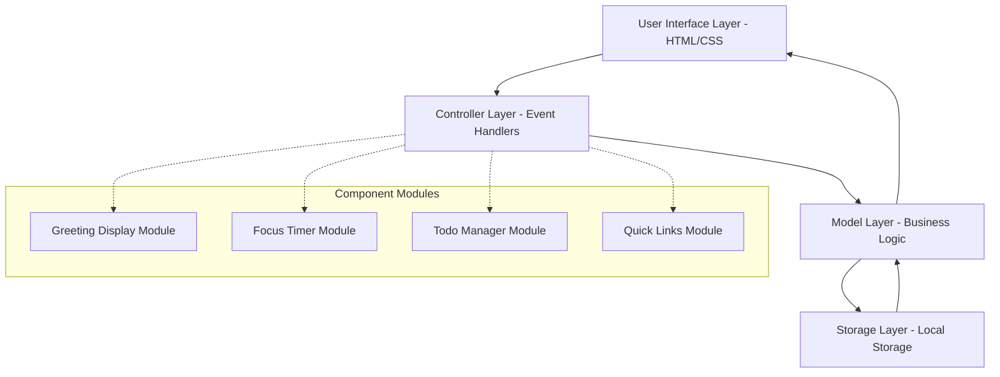
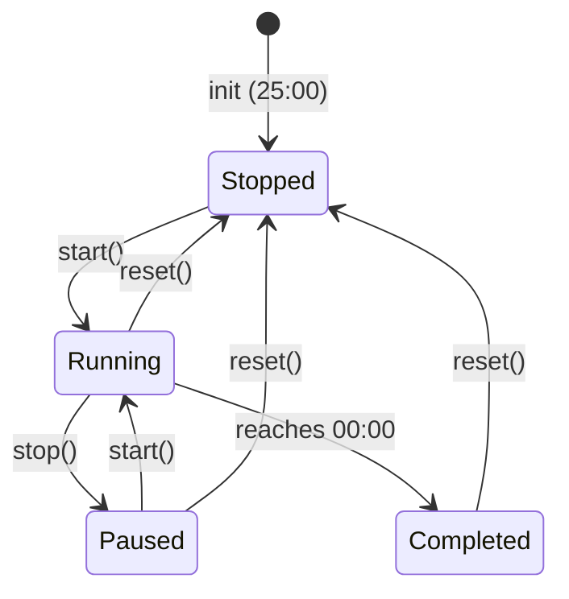

# Technical Design Document: Todo List Life Dashboard

## Overview

The Todo List Life Dashboard is a client-side web application built with vanilla HTML, CSS, and JavaScript that provides an integrated productivity interface. The system combines time awareness (greeting and clock), focus management (Pomodoro timer), task tracking (to-do list), and quick navigation (link shortcuts) into a single cohesive dashboard.

**Architecture Pattern**: The application follows a modified Model-View-Controller (MVC) pattern adapted for client-side vanilla JavaScript, with Local Storage serving as the persistence layer. Each major feature (Greeting Display, Focus Timer, Todo Manager, Quick Links Manager) is implemented as a self-contained module with clear separation of concerns.

**Key Design Principles**:
- **Single Responsibility**: Each component manages one specific feature
- **Event-Driven Communication**: Components communicate through DOM events and observer patterns
- **Persistence-First**: All state changes immediately synchronize to Local Storage
- **Zero Dependencies**: Pure vanilla JavaScript with no frameworks or libraries
- **Performance**: Responsive UI with operations completing within specified time constraints

The application operates entirely in the browser with no server-side dependencies, making it highly portable and privacy-preserving since all data remains on the user's device.

## Architecture

### High-Level Architecture

The application uses a layered architecture with clear separation between presentation, business logic, and data persistence:



### Module Structure

Given the constraint of a single JavaScript file, the application is organized using the Module Pattern with Immediately Invoked Function Expressions (IIFE) to create isolated namespaces:

```javascript
// Main application structure
const App = {
    Storage: {...},          // Storage abstraction layer
    GreetingDisplay: {...},  // Greeting and time display
    FocusTimer: {...},       // Pomodoro timer
    TodoManager: {...},      // Task management
    QuickLinksManager: {...} // Link shortcuts
};
```

Each module exposes only public methods while keeping internal state and helper functions private, achieved through closure scope.

### Data Flow

1. **Initialization Flow**: App loads → Storage layer reads Local Storage → Each module initializes with persisted data → UI renders initial state
2. **User Interaction Flow**: User action → Event handler → Controller updates model → Model updates Local Storage → UI updates to reflect new state
3. **Timer Flow**: setInterval triggers → Timer decrements → UI updates every second → On completion, notification fires

### Storage Strategy

The Storage module provides a centralized abstraction over Local Storage with the following responsibilities:
- Serialize/deserialize JavaScript objects to/from JSON
- Handle storage errors gracefully (quota exceeded, unavailable)
- Provide type-safe getters and setters for specific data types
- Maintain data integrity through atomic updates

**Storage Keys**:
- `dashboard_tasks`: Array of task objects
- `dashboard_links`: Array of link objects
- `dashboard_timer_state`: Timer state (for future persistence if needed)

## Components and Interfaces

### 1. Greeting Display Component

**Purpose**: Displays current time, date, and time-based greeting to provide temporal awareness.

**Responsibilities**:
- Query current system time every second
- Format time as HH:MM
- Format date in readable format (e.g., "Monday, January 15, 2024")
- Determine appropriate greeting based on time period
- Update DOM elements with current values

**Public Interface**:
```javascript
App.GreetingDisplay = {
    init(): void,              // Initialize and start clock
    updateTime(): void,        // Update time display (called every second)
    getGreeting(): string,     // Get appropriate greeting for current time
    destroy(): void            // Clean up intervals
}
```

**Internal State**:
- `clockInterval`: Reference to setInterval for cleanup
- No persistent state needed

**Time Period Mapping**:
- Morning: 05:00-11:59 → "Good Morning"
- Afternoon: 12:00-16:59 → "Good Afternoon"
- Evening: 17:00-20:59 → "Good Evening"
- Night: 21:00-04:59 → "Good Night"

**DOM Elements**:
- `#current-time`: Displays HH:MM
- `#current-date`: Displays formatted date
- `#greeting`: Displays time-based greeting

### 2. Focus Timer Component

**Purpose**: Provides a 25-minute Pomodoro focus timer with start, stop, and reset controls.

**Responsibilities**:
- Maintain timer state (running, paused, stopped)
- Count down from 1500 seconds (25 minutes)
- Format remaining time as MM:SS
- Provide user controls (start, stop, reset)
- Trigger notification when timer completes
- Update UI every second while running

**Public Interface**:
```javascript
App.FocusTimer = {
    init(): void,              // Initialize timer
    start(): void,             // Start or resume countdown
    stop(): void,              // Pause countdown
    reset(): void,             // Reset to 25 minutes
    getRemainingTime(): number, // Get seconds remaining
    formatTime(seconds): string, // Format seconds as MM:SS
    destroy(): void            // Clean up intervals
}
```

**Internal State**:
```javascript
{
    remainingSeconds: number,  // Current countdown value
    isRunning: boolean,        // Whether timer is active
    timerInterval: number      // Reference to setInterval
}
```

**State Machine**:


**Timer Logic**:
- Use `setInterval` with 1000ms interval for countdown
- Store interval reference for proper cleanup
- On each tick: decrement `remainingSeconds`, update display
- When reaching 0: clear interval, show notification, prevent negative values

**Notification Strategy**:
- Use browser's Notification API if available and granted
- Fallback to visual indicator (DOM manipulation) if notifications unavailable
- Provide clear visual feedback that timer completed

**DOM Elements**:
- `#timer-display`: Shows MM:SS format
- `#timer-start`: Start/resume button
- `#timer-stop`: Pause button
- `#timer-reset`: Reset button

### 3. Todo Manager Component

**Purpose**: Manages task lifecycle including creation, editing, completion tracking, and deletion.

**Responsibilities**:
- Maintain task collection in memory and Local Storage
- Render task list to DOM
- Handle task CRUD operations
- Track completion status
- Provide UI controls for each task
- Synchronize all changes to storage within 100ms

**Public Interface**:
```javascript
App.TodoManager = {
    init(): void,                        // Initialize from storage
    addTask(text: string): void,         // Create new task
    editTask(id: string, text: string): void, // Update task text
    toggleComplete(id: string): void,    // Toggle completion status
    deleteTask(id: string): void,        // Remove task
    getTasks(): Task[],                  // Get all tasks
    renderTasks(): void                  // Update DOM display
}
```

**Task Data Model**:
```javascript
{
    id: string,          // Unique identifier (timestamp-based)
    text: string,        // Task description
    completed: boolean,  // Completion status
    createdAt: number    // Unix timestamp
}
```

**Internal State**:
```javascript
{
    tasks: Task[],       // Array of task objects
    editingId: string    // ID of task currently being edited (null if none)
}
```

**Task Operations**:

1. **Add Task**:
   - Validate text is not empty (trim whitespace)
   - Generate unique ID using timestamp + random
   - Create task object with `completed: false`
   - Add to tasks array
   - Save to Local Storage
   - Re-render list
   - Clear input field and focus it

2. **Edit Task**:
   - Display current text in edit mode (inline editing)
   - On confirm: validate new text is not empty
   - Update task object
   - Save to Local Storage
   - Re-render list
   - On cancel: discard changes, exit edit mode

3. **Toggle Complete**:
   - Find task by ID
   - Flip `completed` boolean
   - Save to Local Storage
   - Update visual styling without full re-render

4. **Delete Task**:
   - Remove task from array by ID
   - Save updated array to Local Storage
   - Re-render list

**Rendering Strategy**:
- Generate HTML for each task with appropriate controls
- Apply visual styling based on completion status (e.g., strikethrough, reduced opacity)
- Attach event listeners for edit, complete, delete actions
- Use event delegation for efficiency

**DOM Structure**:
```html
<div id="todo-container">
    <input type="text" id="todo-input" placeholder="Add a task...">
    <button id="todo-add">Add</button>
    <ul id="todo-list">
        <!-- Task items dynamically inserted here -->
    </ul>
</div>
```

Each task item structure:
```html
<li class="todo-item" data-id="{id}">
    <input type="checkbox" class="todo-checkbox" {checked}>
    <span class="todo-text {completed-class}">{text}</span>
    <button class="todo-edit">Edit</button>
    <button class="todo-delete">Delete</button>
</li>
```

### 4. Quick Links Manager Component

**Purpose**: Manages user-defined website shortcuts for quick navigation.

**Responsibilities**:
- Maintain link collection in memory and Local Storage
- Render link buttons to DOM
- Handle link CRUD operations (add, delete)
- Open links in new tabs
- Synchronize all changes to storage within 100ms

**Public Interface**:
```javascript
App.QuickLinksManager = {
    init(): void,                              // Initialize from storage
    addLink(name: string, url: string): void,  // Create new link
    deleteLink(id: string): void,              // Remove link
    getLinks(): Link[],                        // Get all links
    renderLinks(): void                        // Update DOM display
}
```

**Link Data Model**:
```javascript
{
    id: string,          // Unique identifier
    name: string,        // Display name for button
    url: string,         // Target URL
    createdAt: number    // Unix timestamp
}
```

**Internal State**:
```javascript
{
    links: Link[]        // Array of link objects
}
```

**Link Operations**:

1. **Add Link**:
   - Validate name and URL are not empty
   - Ensure URL has protocol (prepend https:// if missing)
   - Generate unique ID
   - Create link object
   - Add to links array
   - Save to Local Storage
   - Re-render buttons
   - Clear input fields

2. **Delete Link**:
   - Remove link from array by ID
   - Save updated array to Local Storage
   - Re-render buttons

3. **Open Link**:
   - Use `window.open(url, '_blank')` to open in new tab
   - Set `noopener` and `noreferrer` for security

**Rendering Strategy**:
- Generate button element for each link
- Display link name as button text
- Attach click handler to open URL
- Include delete control on each button (e.g., small X icon)

**DOM Structure**:
```html
<div id="links-container">
    <input type="text" id="link-name" placeholder="Website name">
    <input type="text" id="link-url" placeholder="URL">
    <button id="link-add">Add Link</button>
    <div id="links-list">
        <!-- Link buttons dynamically inserted here -->
    </div>
</div>
```

Each link button structure:
```html
<div class="link-item" data-id="{id}">
    <button class="link-button">{name}</button>
    <button class="link-delete">×</button>
</div>
```

### 5. Storage Module

**Purpose**: Provides centralized abstraction over Local Storage with error handling and type safety.

**Responsibilities**:
- Serialize/deserialize JavaScript objects
- Handle storage exceptions gracefully
- Provide consistent interface for all components
- Manage storage keys

**Public Interface**:
```javascript
App.Storage = {
    get(key: string): any,              // Retrieve and parse data
    set(key: string, value: any): void, // Serialize and store data
    remove(key: string): void,          // Delete data
    clear(): void,                      // Clear all app data
    isAvailable(): boolean              // Check if Local Storage works
}
```

**Error Handling**:
- Catch `QuotaExceededError` (storage full)
- Catch `SecurityError` (private browsing mode)
- Catch JSON parse errors (corrupted data)
- Log errors to console
- Return sensible defaults (empty arrays/objects) on error

**Implementation Pattern**:
```javascript
get(key) {
    try {
        const item = localStorage.getItem(key);
        return item ? JSON.parse(item) : null;
    } catch (error) {
        console.error(`Storage get error for ${key}:`, error);
        return null;
    }
}
```

## Data Models

### Task Model

Represents a single to-do item.

```javascript
{
    id: string,          // Unique identifier (timestamp + random)
    text: string,        // Task description (1-500 characters)
    completed: boolean,  // Completion status
    createdAt: number    // Unix timestamp (milliseconds)
}
```

**Validation Rules**:
- `id`: Required, must be unique, generated automatically
- `text`: Required, non-empty after trim, max 500 characters
- `completed`: Required, boolean, defaults to false
- `createdAt`: Required, positive integer, auto-generated

**Example**:
```javascript
{
    id: "1705334400000-abc123",
    text: "Complete project documentation",
    completed: false,
    createdAt: 1705334400000
}
```

### Link Model

Represents a quick access website link.

```javascript
{
    id: string,          // Unique identifier
    name: string,        // Display name (1-50 characters)
    url: string,         // Full URL with protocol
    createdAt: number    // Unix timestamp
}
```

**Validation Rules**:
- `id`: Required, unique, auto-generated
- `name`: Required, non-empty after trim, max 50 characters
- `url`: Required, must be valid URL format, protocol added if missing
- `createdAt`: Required, positive integer, auto-generated

**URL Normalization**:
- If URL lacks protocol, prepend `https://`
- Validate URL format before saving
- Store complete URL for reliable navigation

**Example**:
```javascript
{
    id: "1705334500000-def456",
    name: "GitHub",
    url: "https://github.com",
    createdAt: 1705334500000
}
```

### Timer State Model (Future Enhancement)

For potential timer state persistence across page reloads.

```javascript
{
    remainingSeconds: number,  // Seconds left on timer
    isRunning: boolean,        // Timer active state
    lastUpdated: number        // Timestamp of last save
}
```

Currently not implemented, but architecture supports future addition.

## User Interface Design

### Layout Structure

The dashboard uses a centered single-page layout with distinct sections for each component:

```
┌─────────────────────────────────────┐
│         Greeting Display            │
│    Good Morning                     │
│    10:45                            │
│    Monday, January 15, 2024         │
├─────────────────────────────────────┤
│         Focus Timer                 │
│           25:00                     │
│    [Start] [Stop] [Reset]           │
├─────────────────────────────────────┤
│         Todo List                   │
│    [Add Task Input] [Add]           │
│    ☐ Task 1              [Edit] [×] │
│    ☑ Task 2              [Edit] [×] │
├─────────────────────────────────────┤
│         Quick Links                 │
│    [Name] [URL] [Add Link]          │
│    [GitHub ×] [Gmail ×] [Docs ×]    │
└─────────────────────────────────────┘
```

### Visual Design Principles

**Color Scheme**:
- Primary background: Light neutral (e.g., #f5f5f5)
- Content sections: White cards with subtle shadows
- Primary accent: Calm blue (e.g., #4a90e2)
- Success states: Soft green (e.g., #5cb85c)
- Text: Dark gray for readability (e.g., #333333)

**Typography**:
- Headers: 24-32px, bold weight, sans-serif
- Body text: 16px, normal weight, sans-serif
- Timer display: 48px, monospace for alignment
- Button text: 14-16px, medium weight

**Spacing**:
- Section padding: 20-24px
- Component margin: 16-20px vertical spacing
- Button padding: 10px 20px
- Input padding: 8px 12px

**Interactive Elements**:
- Buttons: Rounded corners (4-6px), hover state with slight darkening
- Inputs: Clear borders, focus state with accent color border
- Checkboxes: Custom styled for better visual appeal
- Hover feedback: 50ms transition for smooth experience

### Responsive Behavior

While not specified in requirements, basic responsive design ensures usability:
- Max width: 800px for comfortable reading
- Centered layout with margins
- Stack components vertically on narrow screens
- Ensure touch targets are at least 44px for mobile

### Accessibility Considerations

- Semantic HTML elements (section, button, input)
- ARIA labels for icon-only buttons
- Keyboard navigation support
- Sufficient color contrast (WCAG AA minimum)
- Focus indicators on interactive elements

## Correctness Properties

*A property is a characteristic or behavior that should hold true across all valid executions of a system—essentially, a formal statement about what the system should do. Properties serve as the bridge between human-readable specifications and machine-verifiable correctness guarantees.*

Before defining properties, I need to assess whether property-based testing is appropriate for this application.

**PBT Applicability Assessment**:

This Todo List Life Dashboard includes several types of functionality:
1. **UI rendering and interaction** (greeting display, visual feedback, layout)
2. **Timer countdown logic** (pure function behavior with state management)
3. **Data transformation and persistence** (CRUD operations on tasks/links)
4. **Browser API interaction** (Local Storage, DOM manipulation, Notification API)

**PBT is appropriate for**:
- Task and link CRUD operations (data transformation)
- Local Storage serialization/deserialization (round-trip properties)
- Timer state transitions and time formatting
- Input validation logic

**PBT is NOT appropriate for**:
- Visual styling and UI aesthetics (Requirements 15)
- Browser compatibility checks (Requirement 17)
- Actual DOM rendering output (requires visual inspection)
- Notification API behavior (external browser dependency)
- Performance timing constraints (Requirement 16)

**Decision**: Property-based testing IS applicable for the core business logic (task management, link management, timer logic, storage operations) but NOT for UI rendering, browser compatibility, or performance requirements. I will proceed with correctness properties for the testable logic.

Now I'll use the prework tool to analyze acceptance criteria:


### Reflection on Property Redundancy

Reviewing all identified properties to eliminate redundancy:

**Time/Greeting Properties**:
- 1.1, 1.2: Time and date formatting are distinct properties (different formats)
- 2.1-2.4: All four greeting criteria can be combined into ONE comprehensive property about time-to-greeting mapping

**Timer Properties**:
- 3.3: Timer formatting is a distinct property
- 4.1, 4.2, 4.3: State transitions can be combined into a comprehensive state machine property
- 4.4, 4.5: These are the same property (reset from any state returns to 1500)

**Task CRUD Properties**:
- 5.1, 5.5: Can be combined (creation includes setting completed=false)
- 5.2: List length invariant (distinct property)
- 5.3, 6.3, 7.4, 8.2: All storage persistence - can be combined into ONE round-trip property for tasks
- 5.4, 6.4: Both validate empty input - can be combined into ONE validation property
- 6.2: Edit preserves ID (distinct property)
- 7.1, 7.3: Toggle behavior can be combined into ONE toggle property (bidirectional)
- 8.1: Delete reduces length (distinct invariant property)
- 9.2: Storage round-trip already covered above

**Link CRUD Properties**:
- 10.1: Link creation (distinct property)
- 10.2: List length invariant (distinct property)
- 10.3, 12.2: Storage persistence - ONE round-trip property for links
- 10.4: Input validation (distinct property)
- 11.2: Button text matches name (distinct property)
- 12.1: Delete reduces length (distinct invariant property)
- 13.2: Storage round-trip already covered above

**Eliminated Redundancies**:
- Merged 2.1-2.4 into single greeting property
- Merged 4.4 and 4.5 into single reset property
- Merged 5.1 and 5.5 into single task creation property
- Merged 5.3, 6.3, 7.4, 8.2, 9.2 into single task persistence property
- Merged 5.4 and 6.4 into single task validation property
- Merged 7.1 and 7.3 into single toggle property
- Merged 10.3, 12.2, 13.2 into single link persistence property

### Property 1: Time Formatting

*For any* valid Date object, formatting the time SHALL produce a string matching the pattern HH:MM where HH is 00-23 and MM is 00-59.

**Validates: Requirements 1.1**

### Property 2: Date Formatting

*For any* valid Date object, formatting the date SHALL produce a readable string containing the day of week, month name, day of month, and year.

**Validates: Requirements 1.2**

### Property 3: Time-Based Greeting

*For any* valid time of day (0-23 hours), the greeting function SHALL return exactly one of four values: "Good Morning" for 05:00-11:59, "Good Afternoon" for 12:00-16:59, "Good Evening" for 17:00-20:59, or "Good Night" for 21:00-04:59.

**Validates: Requirements 2.1, 2.2, 2.3, 2.4**

### Property 4: Timer Display Formatting

*For any* integer value between 0 and 1500 seconds (inclusive), the timer format function SHALL produce a string matching the pattern MM:SS where MM is 00-25 and SS is 00-59.

**Validates: Requirements 3.3**

### Property 5: Timer State Transitions

*For any* valid timer state (stopped, running, paused), the following transitions SHALL be valid: start() moves stopped→running or paused→running; stop() moves running→paused; and the state SHALL remain consistent after each transition.

**Validates: Requirements 4.1, 4.2, 4.3**

### Property 6: Timer Reset

*For any* timer state (stopped, running, or paused) with any remaining time value, calling reset() SHALL set remainingSeconds to 1500 and state to stopped.

**Validates: Requirements 4.4, 4.5**

### Property 7: Task Creation

*For any* non-empty string (after trimming), creating a task SHALL produce a Task object where text equals the input string, completed equals false, id is unique, and createdAt is a valid timestamp.

**Validates: Requirements 5.1, 5.5**

### Property 8: Task List Growth Invariant

*For any* task list with length N, adding a valid task SHALL result in a list with length N+1, and deleting an existing task SHALL result in a list with length N-1.

**Validates: Requirements 5.2, 8.1, 10.2, 12.1**

### Property 9: Task Input Validation

*For any* string composed entirely of whitespace characters (spaces, tabs, newlines) or empty string, attempting to create or edit a task with that string SHALL be rejected and the task list SHALL remain unchanged.

**Validates: Requirements 5.4, 6.4**

### Property 10: Task Storage Round-Trip

*For any* task or array of tasks, saving to Local Storage and then retrieving SHALL produce a value that is deeply equal to the original (same id, text, completed status, and createdAt for each task).

**Validates: Requirements 5.3, 6.3, 7.4, 8.2, 9.2**

### Property 11: Task Edit Preserves Identity

*For any* task with a given id, editing the task's text SHALL produce an updated task where the id remains unchanged, but the text field contains the new value.

**Validates: Requirements 6.2**

### Property 12: Task Completion Toggle

*For any* task, toggling completion SHALL flip the completed boolean value: if it was true, it becomes false; if it was false, it becomes true. Toggling twice SHALL return the task to its original state (idempotence of double toggle).

**Validates: Requirements 7.1, 7.3**

### Property 13: Link Creation

*For any* non-empty name string and non-empty URL string, creating a link SHALL produce a Link object where name equals the input name, url contains the input URL (with https:// protocol if not provided), id is unique, and createdAt is a valid timestamp.

**Validates: Requirements 10.1**

### Property 14: Link Input Validation

*For any* combination where either name or URL is empty (after trimming) or composed entirely of whitespace, attempting to create a link SHALL be rejected and the link list SHALL remain unchanged.

**Validates: Requirements 10.4**

### Property 15: Link Storage Round-Trip

*For any* link or array of links, saving to Local Storage and then retrieving SHALL produce a value that is deeply equal to the original (same id, name, url, and createdAt for each link).

**Validates: Requirements 10.3, 12.2, 13.2**

### Property 16: Link Button Text Mapping

*For any* link with a given name property, the rendered button text SHALL exactly match that name property value.

**Validates: Requirements 11.2**

## Error Handling

### Storage Errors

**Quota Exceeded**:
- Catch `QuotaExceededError` when storage limit reached
- Display user-friendly error message: "Storage full. Please delete some items."
- Allow continued operation with existing data
- Log error details to console for debugging

**Storage Unavailable**:
- Detect when Local Storage is unavailable (private browsing, disabled)
- Display warning: "Browser storage unavailable. Data will not persist."
- Allow app to function in memory-only mode
- Check availability on init using `Storage.isAvailable()`

**Data Corruption**:
- Catch JSON parse errors when reading from storage
- Log error to console with corrupted key name
- Return empty array/default value instead of crashing
- Consider adding data validation/migration layer

### Input Validation Errors

**Task Input**:
- Empty or whitespace-only text: Silent rejection (no error message), maintain state
- Text exceeding 500 characters: Truncate or show character count warning
- Invalid characters: Allow all Unicode (no restrictions)

**Link Input**:
- Empty name or URL: Silent rejection (no error message)
- Invalid URL format: Attempt to prepend https://, validate result
- Malformed URL: Show error message "Please enter a valid URL"

### Timer Errors

**Negative Time**:
- Prevent remainingSeconds from going below 0
- Stop countdown when reaching 0
- Use Math.max(0, value) as safety check

**Notification Failure**:
- Check Notification.permission before attempting
- Gracefully fallback to visual indicator if permission denied
- Don't crash if Notification API unavailable

### DOM Errors

**Missing Elements**:
- Check for element existence before manipulation
- Fail gracefully if expected DOM elements not found
- Log error to console for debugging

**Event Handler Errors**:
- Wrap handlers in try-catch to prevent crashes
- Log errors to console
- Allow continued operation of other features

### General Error Handling Strategy

1. **Defensive Programming**: Validate inputs at boundaries
2. **Fail Gracefully**: Never crash the entire app for single feature errors
3. **User Communication**: Show helpful messages for user-facing errors
4. **Developer Visibility**: Console.log all errors with context
5. **Feature Isolation**: Errors in one component shouldn't break others

## Testing Strategy

### Overview

The testing strategy employs a dual approach combining property-based testing for core business logic with example-based unit tests and integration tests for UI behavior, browser compatibility, and performance requirements.

### Property-Based Testing

**Library**: Use [fast-check](https://fast-check.dev/) for JavaScript property-based testing

**Configuration**: Each property test MUST run minimum 100 iterations to ensure comprehensive input coverage

**Tagging**: Each property test MUST include a comment referencing its design property:
```javascript
// Feature: todo-list-life-dashboard, Property 1: Time Formatting
```

**Test Organization**:
```
tests/
  properties/
    time-formatting.test.js      // Properties 1-3 (Greeting Display)
    timer-logic.test.js          // Properties 4-6 (Focus Timer)
    task-operations.test.js      // Properties 7-12 (Todo Manager)
    link-operations.test.js      // Properties 13-16 (Quick Links)
    storage-persistence.test.js  // Properties 10, 15 (Storage)
```

**Property Test Examples**:

*Property 1: Time Formatting*
```javascript
// Feature: todo-list-life-dashboard, Property 1: Time Formatting
fc.assert(
  fc.property(
    fc.date(), // Generate random dates
    (date) => {
      const formatted = App.GreetingDisplay.formatTime(date);
      return /^([0-1][0-9]|2[0-3]):[0-5][0-9]$/.test(formatted);
    }
  ),
  { numRuns: 100 }
);
```

*Property 8: Task List Growth Invariant*
```javascript
// Feature: todo-list-life-dashboard, Property 8: Task List Growth Invariant
fc.assert(
  fc.property(
    fc.array(taskGenerator()), // Generate random task arrays
    fc.string({ minLength: 1 }), // Generate non-empty string
    (taskList, newTaskText) => {
      const initialLength = taskList.length;
      const manager = createManagerWithTasks(taskList);
      manager.addTask(newTaskText.trim());
      return manager.getTasks().length === initialLength + 1;
    }
  ),
  { numRuns: 100 }
);
```

*Property 12: Task Completion Toggle*
```javascript
// Feature: todo-list-life-dashboard, Property 12: Task Completion Toggle
fc.assert(
  fc.property(
    taskGenerator(), // Generate random task
    (task) => {
      const manager = createManagerWithTasks([task]);
      const original = task.completed;
      
      // Toggle once
      manager.toggleComplete(task.id);
      const afterFirst = manager.getTasks()[0].completed;
      
      // Toggle twice (should return to original)
      manager.toggleComplete(task.id);
      const afterSecond = manager.getTasks()[0].completed;
      
      return afterFirst === !original && afterSecond === original;
    }
  ),
  { numRuns: 100 }
);
```

### Unit Testing

**Purpose**: Test specific examples, edge cases, and UI interactions not suitable for property-based testing

**Framework**: Use a simple test runner like Mocha or Jest

**Coverage Areas**:
- Specific initialization scenarios (Requirements 3.1, 9.1, 13.1)
- UI rendering and DOM manipulation (Requirements 6.1, 7.2, 15.1-15.5)
- Event handler behavior
- Edge cases covered by property generators (empty storage, boundary values)

**Example Unit Tests**:

```javascript
describe('Timer Initialization', () => {
  it('should initialize with 25 minutes (1500 seconds)', () => {
    const timer = App.FocusTimer;
    timer.init();
    expect(timer.getRemainingTime()).toBe(1500);
  });
});

describe('Task Edit UI', () => {
  it('should display edit interface when edit button clicked', () => {
    const task = { id: '123', text: 'Test Task', completed: false };
    App.TodoManager.addTask(task.text);
    clickEditButton('123');
    expect(document.querySelector('.edit-input')).toExist();
  });
});
```

### Integration Testing

**Purpose**: Test browser API integration, performance requirements, and cross-browser compatibility

**Coverage Areas**:
- Local Storage integration (actual browser storage)
- Notification API integration (Requirement 3.5)
- Performance timing (Requirements 8.3, 9.3, 12.3, 16.1-16.3)
- Browser compatibility (Requirements 17.1-17.4)
- Real-time timer behavior (Requirements 3.2, 1.3)

**Tools**:
- Playwright or Puppeteer for cross-browser testing
- Performance.now() for timing measurements
- Real browser environments for compatibility testing

**Example Integration Tests**:

```javascript
describe('Local Storage Persistence', () => {
  it('should persist tasks across page reloads', async () => {
    // Add tasks
    await page.evaluate(() => {
      App.TodoManager.addTask('Task 1');
      App.TodoManager.addTask('Task 2');
    });
    
    // Reload page
    await page.reload();
    
    // Verify tasks still present
    const tasks = await page.evaluate(() => App.TodoManager.getTasks());
    expect(tasks).toHaveLength(2);
  });
});

describe('Performance Requirements', () => {
  it('should update display within 100ms after storage operation', async () => {
    const start = performance.now();
    await page.evaluate(() => App.TodoManager.addTask('Fast Task'));
    const end = performance.now();
    expect(end - start).toBeLessThan(100);
  });
});
```

### Smoke Testing

**Purpose**: Verify project structure and basic configuration

**Coverage**: Requirements 14.1-14.4, 17.5

**Tests**:
- Verify exactly one CSS file in css/ directory
- Verify exactly one JS file in js/ directory
- Verify HTML entry point exists
- Verify no framework CDN links in HTML
- Verify app loads without extensions

### Test Execution Strategy

1. **Development**: Run property tests and unit tests on every change (fast feedback loop)
2. **Pre-commit**: Run full property test suite with 100 iterations
3. **CI/CD**: Run all tests including integration and cross-browser tests
4. **Manual**: Perform visual inspection and usability testing for Requirements 15

### Custom Generators for Property Tests

Define reusable generators for domain objects:

```javascript
// Task generator
const taskGenerator = () => fc.record({
  id: fc.string(),
  text: fc.string({ minLength: 1, maxLength: 500 }),
  completed: fc.boolean(),
  createdAt: fc.nat()
});

// Link generator
const linkGenerator = () => fc.record({
  id: fc.string(),
  name: fc.string({ minLength: 1, maxLength: 50 }),
  url: fc.webUrl(),
  createdAt: fc.nat()
});

// Time generator (hours 0-23)
const timeGenerator = () => fc.integer({ min: 0, max: 23 });

// Whitespace string generator
const whitespaceGenerator = () => fc.stringOf(
  fc.constantFrom(' ', '\t', '\n', '\r')
);
```

### Mocking Strategy

For tests requiring isolation:
- Mock Local Storage: Use in-memory map for predictable behavior
- Mock DOM: Use JSDOM for unit tests without browser
- Mock Notification API: Spy on notification calls
- Mock setInterval/setTimeout: Use fake timers for deterministic time

### Testing Priorities

**High Priority** (must pass):
- All property tests (Properties 1-16)
- Storage persistence and round-trip properties
- Input validation properties
- State machine correctness

**Medium Priority** (should pass):
- UI interaction examples
- Performance benchmarks
- Cross-browser compatibility

**Low Priority** (nice to have):
- Visual design validation
- Aesthetic quality checks

## Implementation Notes

### Module Pattern Structure

```javascript
const App = (() => {
  'use strict';
  
  // Private helper functions
  const generateId = () => `${Date.now()}-${Math.random().toString(36)}`;
  
  // Storage module
  const Storage = (() => {
    // Implementation
    return { get, set, remove, clear, isAvailable };
  })();
  
  // Greeting Display module
  const GreetingDisplay = (() => {
    // Private state
    let clockInterval = null;
    
    // Implementation
    return { init, updateTime, getGreeting, destroy };
  })();
  
  // Other modules...
  
  // Public API
  return {
    Storage,
    GreetingDisplay,
    FocusTimer,
    TodoManager,
    QuickLinksManager,
    init: () => {
      GreetingDisplay.init();
      FocusTimer.init();
      TodoManager.init();
      QuickLinksManager.init();
    }
  };
})();

// Initialize when DOM ready
document.addEventListener('DOMContentLoaded', () => App.init());
```

### Event Delegation Pattern

Use event delegation for dynamically created elements (tasks, links):

```javascript
document.getElementById('todo-list').addEventListener('click', (e) => {
  if (e.target.classList.contains('todo-delete')) {
    const id = e.target.closest('.todo-item').dataset.id;
    App.TodoManager.deleteTask(id);
  }
  // Handle other events...
});
```

### Performance Optimization

**DOM Updates**:
- Batch DOM updates to minimize reflows
- Use DocumentFragment for multiple insertions
- Update only changed elements when possible

**Storage Operations**:
- Debounce rapid successive saves (100ms threshold met)
- Serialize once, store once per change
- Use efficient JSON.stringify for large arrays

**Timer Efficiency**:
- Single setInterval for clock update
- Single setInterval for timer countdown
- Clear intervals on destroy to prevent leaks

### CSS Organization

Single CSS file structure:
```css
/* Reset and base styles */
* { box-sizing: border-box; }

/* Layout */
.container { max-width: 800px; margin: 0 auto; }

/* Components */
.greeting-display { /* styles */ }
.focus-timer { /* styles */ }
.todo-manager { /* styles */ }
.quick-links { /* styles */ }

/* States */
.todo-item.completed { text-decoration: line-through; }
.timer.running { /* styles */ }

/* Responsive */
@media (max-width: 768px) { /* mobile styles */ }
```

### Accessibility Enhancements

- Use semantic HTML5 elements (section, button, input)
- Include ARIA labels for icon-only buttons:
  ```html
  <button aria-label="Delete task" class="todo-delete">×</button>
  ```
- Ensure keyboard navigation works for all interactions
- Maintain focus management (e.g., focus input after adding task)
- Provide sufficient color contrast ratios (WCAG AA: 4.5:1 for text)

### Browser Compatibility Notes

**Features Used**:
- Local Storage (supported in all target browsers)
- ES6 features (const, let, arrow functions, template literals)
- Notification API (optional, with fallback)
- Date object and methods

**Potential Issues**:
- Notification API requires HTTPS in production
- Some older ES6 features may need transpilation for broader support
- Consider using polyfills only if targeting older versions

### Development Workflow

1. **Setup**: Create project structure (index.html, css/style.css, js/app.js)
2. **Core Implementation**: Build Storage module first, then each feature module
3. **Testing**: Write property tests as each module is implemented
4. **Integration**: Connect modules and test interactions
5. **Styling**: Apply CSS after functionality complete
6. **Testing**: Run full test suite including cross-browser
7. **Optimization**: Profile performance and optimize as needed

## Conclusion

This design provides a comprehensive blueprint for building the Todo List Life Dashboard as a maintainable, testable, and user-friendly vanilla JavaScript application. The architecture emphasizes separation of concerns, property-based testing for correctness, and graceful error handling to ensure a robust user experience.

Key architectural decisions include:
- Module pattern for code organization within single JS file constraint
- MVC-inspired separation of models, views, and controllers
- Storage abstraction layer for persistence
- Event-driven communication between components
- Property-based testing for comprehensive correctness validation

The design addresses all 17 requirements with specific implementation strategies, correctness properties for testable behaviors, and clear testing approaches for validation.
